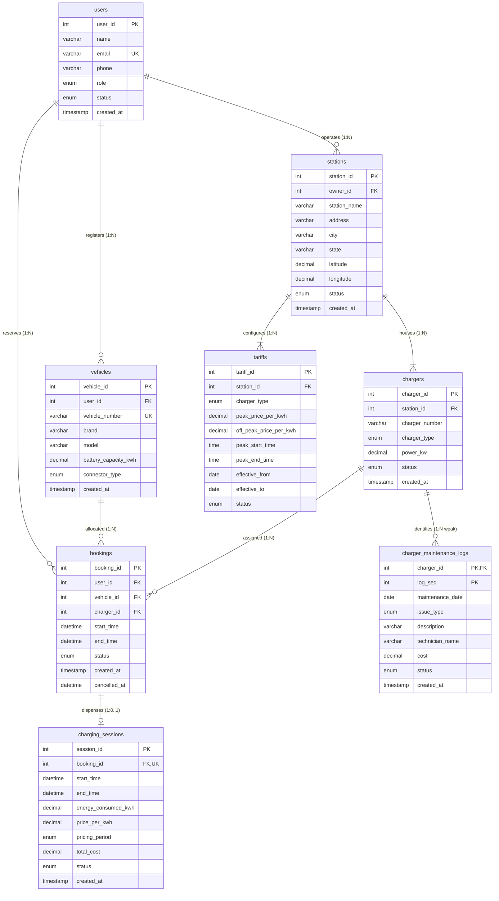

# ⚡ EV Charging Station Slot Booking & Energy Log

A clean, production-grade MySQL database solution for managing electric vehicle (EV) charging stations, advance slot reservations, hardware availability, and dynamic energy billing.

---

## 📌 Project Overview

As electric vehicles grow in popularity, charging station networks need a reliable backend database to handle:

1. **Slot Reservations**: Allowing EV drivers to book charging bays in advance without scheduling collisions.

2. **Dynamic Pricing**: Applying fair rates based on Peak vs. Off-Peak electricity hours.

3. **Hardware Availability**: Real-time tracking of whether chargers are free (`AVAILABLE`) or charging (`OCCUPIED`).

4. **Transparent Billing**: Recording exact energy drawn (kWh) and computing transparent bills.

This project delivers a **pure SQL solution** using **MySQL 8.x** with normalized tables, stored procedures, triggers, views, and an essential curated query collection.

---

## 🚗 The 6 Core Business Rules

The entire platform is governed by **6 clear, production-grade business rules** (documented in [`Business_Rules.md`](Business_Rules.md)):

| # | Rule Name | Description | Database Enforcement |
|---|---|---|---|
| **1** | **🚙 Vehicle Ownership** | Drivers can only book charging slots for vehicles registered to their own account. | Validated in `sp_create_booking` and `trg_bookings_before_insert`. |
| **2** | **🚫 No Double-Booking** | Two drivers cannot reserve the same charger during overlapping time slots. | Overlap condition: `start1 < end2 AND end1 > start2`. Enforced in procedure and trigger. |
| **3** | **⏱️ Valid Booking Time** | Reservation end time must always be after start time (`end_time > start_time`). | DDL `CHECK (end_time > start_time)`. |
| **4** | **⚡ Dynamic Pricing** | Cost = $\text{Energy Consumed (kWh)} \times \text{Rate}$. Peak hours cost more; off-peak costs less. | Resolved dynamically in `sp_end_charging_session` using `tariffs` table. |
| **5** | **🟢 Auto Charger Status** | Hardware status updates automatically: `AVAILABLE` when free, `OCCUPIED` during active charging. | Managed by triggers `trg_sessions_after_insert` and `trg_sessions_after_update`. |
| **6** | **🛠️ Weak Entity Logs** | Service logs scoped `(charger_id, log_seq)`; cascade-deleted if charger is removed. | Composite PK, discriminator check, and `ON DELETE CASCADE`. |

---

## 🏗️ Database Architecture & Relational Schema

The database strictly contains **8 normalized tables** (7 Strong Entities + 1 Weak Entity in Third Normal Form - 3NF):

```
users (Customers, Station Owners, Admins)
│
├── vehicles (Customer EV Fleet)
│
├── stations (Physical Charging Hubs)
│   ├── chargers (Charging Bays / Dispensers)
│   │   └── charger_maintenance_logs [WEAK ENTITY] (Service & Repair Logs)
│   └── tariffs (Peak & Off-Peak Rate Schedules)
│
└── bookings (Slot Reservations)
    └── charging_sessions (Energy Dispensed & Billing Ledger)
```



---

## 📁 Repository Structure

```
EV-Charging-Station-SQL/
│
├── README.md                   # Complete architectural overview and quick-start guide
├── Business_Rules.md           # 6 core operational and weak entity lifecycle rules
├── ER-Diagram.png              # Entity-Relationship diagram (Chen's notation with Weak Entity)
├── ER-Diagram.svg              # Scalable vector source for presentation slides
├── Relational-Schema.png       # Relational Schema diagram (Crow's Foot notation)
│
└── sql/
    ├── 01_database_setup.sql       # Database creation & environment setup
    ├── 02_table_creation.sql       # 8 tables (7 Strong Entities + 1 Weak Entity) with PK/FK/CHECK
    ├── 03_sample_data.sql          # 12 users, 14 vehicles, 5 stations, 14 chargers, 15 bookings, 12 sessions, 15 logs
    ├── 04_constraints.sql          # Primary, Foreign Key, Weak Entity Composite PK & CASCADE audits
    ├── 05_stored_procedures.sql    # Atomic procedures (create booking, sessions, dynamic billing)
    ├── 06_triggers.sql             # Automatic hardware status sync & overlap guards
    ├── 07_views.sql                # 8 operational, financial, and analytical reporting views
    ├── 08_indexes.sql              # B-Tree secondary indexes with EXPLAIN execution plan analysis
    └── 09_curated_queries.sql      # 40 essential queries balanced across Simple, Moderate, Hard, and Weak Entity tiers
```

---

## 🚀 Quick Start Guide

### 1. Execute SQL Scripts Sequentially

Open MySQL Workbench or MySQL CLI and run the scripts in order:

```sql
SOURCE sql/01_database_setup.sql;
SOURCE sql/02_table_creation.sql;
SOURCE sql/03_sample_data.sql;
SOURCE sql/04_constraints.sql;
SOURCE sql/05_stored_procedures.sql;
SOURCE sql/06_triggers.sql;
SOURCE sql/07_views.sql;
SOURCE sql/08_indexes.sql;
SOURCE sql/09_curated_queries.sql;
```

### 2. Verify Database Health

```sql
USE ev_charging_db;
SELECT 'users' AS entity, COUNT(*) AS count FROM users
UNION ALL SELECT 'vehicles', COUNT(*) FROM vehicles
UNION ALL SELECT 'stations', COUNT(*) FROM stations
UNION ALL SELECT 'chargers', COUNT(*) FROM chargers
UNION ALL SELECT 'tariffs', COUNT(*) FROM tariffs
UNION ALL SELECT 'bookings', COUNT(*) FROM bookings
UNION ALL SELECT 'charging_sessions', COUNT(*) FROM charging_sessions
UNION ALL SELECT 'charger_maintenance_logs', COUNT(*) FROM charger_maintenance_logs;
```

**Expected Record Counts:**

* Users: **12** (8 Customers, 3 Station Owners, 1 Admin)

* Vehicles: **14** (Tata, MG, Hyundai, Kia, BMW, BYD, Nissan)

* Stations: **5** (Bengaluru, Hyderabad, Mumbai)

* Chargers: **14** (AC, DC_FAST, DC_ULTRA_FAST)

* Tariffs: **12** (Station and charger type specific)

* Bookings: **15** (COMPLETED, BOOKED, CANCELLED, NO_SHOW)

* Sessions: **12** (10 COMPLETED, 2 ACTIVE)

* Charger Maintenance Logs: **15** (Weak Entity scoped 1..N per charger)

---

## 🧪 Stored Procedures in Action

### 1. Create Slot Booking

```sql
CALL sp_create_booking(
    1,                      -- User ID (Rajesh Sharma)
    1,                      -- Vehicle ID (MH-02-EV-1001)
    2,                      -- Charger ID (IND-DC-02)
    '2026-10-15 10:00:00',  -- Start Time
    '2026-10-15 11:00:00',  -- End Time
    @new_booking_id
);
SELECT @new_booking_id;
```

### 2. Start Charging Session

```sql
CALL sp_start_charging_session(@new_booking_id, @new_session_id);
\-- Charger IND-DC-02 is now automatically marked OCCUPIED (Rule 5)
```

### 3. Conclude Charging Session & Compute Bill

```sql
CALL sp_end_charging_session(@new_session_id, 32.50, '2026-10-15 10:45:00');
\-- Automatically detects PEAK hours, applies ₹18.00/kWh rate -> Total: ₹585.00 (Rule 4)
\-- Charger IND-DC-02 is automatically released back to AVAILABLE (Rule 5)
```

### 4. Cancel Booking

```sql
CALL sp_cancel_booking(50, 8);
\-- Validates ownership, ensures session hasn't started, stamps cancelled_at timestamp
```

---

## 📊 Essential Curated Queries (40 Queries)

The primary query collection is consolidated in [`sql/09_curated_queries.sql`](sql/09_curated_queries.sql) (40 queries total across 4 difficulty tiers):

### 🟢 Tier 1: Simple / Basic (Q01 – Q12)

* **Q01**: Active Customer Directory (`SELECT`, `WHERE`, `ORDER BY`)

* **Q02**: Formatted Vehicle Summary (`CONCAT`, string formatting)

* **Q03**: High-Power Fast Charger Lookup (Numeric comparison `>=`)

* **Q04**: Compatible Vehicle Connector Filter (Set membership `IN`)

* **Q05**: Real-Time Hardware Availability (`status = 'AVAILABLE'`)

* **Q06**: Peak-Hours Tariff Pricing & Surcharge Analysis (Arithmetic difference)

* **Q07**: Booking Date & Time Extraction (`DATE`, `TIME`, `DAYNAME`, `TIMESTAMPDIFF`)

* **Q08**: Booking Cancellations Audit (`IS NOT NULL` & status filter)

* **Q09**: High-Energy Charging Sessions (`ROUND`, threshold filter)

* **Q10**: Network KPI Summary (`COUNT`, `SUM`, `AVG`)

* **Q11**: Vehicle Fleet Distribution by Brand (`GROUP BY`, `COUNT`, `AVG`)

* **Q12**: Charger Hardware Inventory Breakdown (`GROUP BY`, `MIN`, `MAX`, `AVG`)

### 🟡 Tier 2: Moderate / Intermediate (Q13 – Q24)

* **Q13**: Full 5-Table Booking Audit Join (Multi-table `INNER JOIN`)

* **Q14**: Charger Utilization & Unbooked Asset Detection (`LEFT JOIN`)

* **Q15**: Station Revenue & Energy Performance (Multi-table aggregation)

* **Q16**: Customer Lifetime Value (CLV) & Spend Profile (`GROUP BY` customer)

* **Q17**: High-Volume Stations via `HAVING` Filter (`HAVING SUM(...) > threshold`)

* **Q18**: Idle Hardware Detection (Subquery with `NOT IN`)

* **Q19**: Inactive Driver Discovery (Correlated subquery with `NOT EXISTS`)

* **Q20**: Above-Average Energy Sessions (Scalar subquery comparison)

* **Q21**: Charger Speed Classification (Categorical `CASE WHEN`)

* **Q22**: Peak vs Off-Peak Revenue Split (Conditional aggregation `SUM(CASE WHEN...)`)

* **Q23**: Commercial Payout Split: Owner Share vs Platform Fee (Financial modeling)

* **Q24**: System-Wide Entity Rollup (Executive `UNION ALL` dashboard)

### 🔴 Tier 3: Hard / Advanced (Q25 – Q36)

* **Q25**: Top-1 Revenue Session per Station (`ROW_NUMBER()` + `CTE`)

* **Q26**: Dense Ranking of Stations by Total Revenue (`DENSE_RANK()`)

* **Q27**: Customer Energy Consumption Leaderboard (`RANK()` with ties)

* **Q28**: Charger Hardware Power Stratification (`NTILE(3)` bucketing)

* **Q29**: Cumulative Running Total of Network Revenue (Window running sum)

* **Q30**: Cumulative Running Revenue Partitioned by Station (`PARTITION BY`)

* **Q31**: Session Variance & Contribution vs Station Average (Window benchmark `AVG`)

* **Q32**: Charger Turnaround & Idle Interval Analysis (`LAG()` window function)

* **Q33**: Week-Over-Week Revenue Growth Trends (`LAG()` + growth ratio)

* **Q34**: Station Revenue Pivot Matrix by Charger Technology (Cross-tabulation pivot)

* **Q35**: Customer RFM Segmentation & Loyalty Tier Scoring (Multi-CTE + `NTILE(4)`)

* **Q36**: Algorithmic Slot Collision & Overlap Audit (Self-join overlap detector)

### 🟣 Tier 4: Weak Entity Operational & Audit Queries (Q37 – Q40)

* **Q37**: Weak Entity Identifying Parent-Child Join (Multi-table `INNER JOIN` traversing Stations $\to$ Chargers $\to$ Logs)

* **Q38**: Cumulative Maintenance Expenditure per Station & Hardware Bay (`GROUP BY ... WITH ROLLUP`)

* **Q39**: Active Hardware Fault Isolation for Offline Chargers (Filter on `status = 'MAINTENANCE'`)

* **Q40**: Weak Entity Partial Key Sequence Audit (`ROW_NUMBER() OVER (PARTITION BY charger_id)`)

---

## 🎯 Rule Verification Matrix

Each of the 6 core business rules is actively verified by the database:

| Rule | Tested Behavior | Verification Result |
|---|---|---|
| **Rule 1: Vehicle Ownership** | Booking a slot with a vehicle ID owned by another user | **REJECTED** (Error 45000: **Vehicle does not belong to user**) |
| **Rule 2: No Double-Booking** | Reserving an already-booked charger during an overlapping time window | **REJECTED** (Error 45000: **Charger is already booked for this slot**) |
| **Rule 3: Valid Time** | Attempting to insert a booking where `end_time <= start_time` | **REJECTED** (MySQL CHECK constraint violation) |
| **Rule 4: Dynamic Pricing** | Calculating session cost during Peak vs Off-Peak windows | **PASSED** (Peak rate ₹18.00 applied for morning; ₹12.00 for night) |
| **Rule 5: Auto Status** | Starting session marks charger `OCCUPIED`; ending sets back to `AVAILABLE` | **PASSED** (Hardware status stays 100% in sync automatically) |
| **Rule 6: Weak Entity Cascade** | Deleting a parent charger cascades deletion to its maintenance records | **PASSED** (`ON DELETE CASCADE` verified in `information_schema`) |

---

## 📜 Portfolio Summary

Built as a clean, easy-to-explain MySQL portfolio project. It demonstrates relational data modeling, dynamic ToU pricing, transaction safety, automated triggers, analytical views, and window functions — all while staying simple, sweet, and practical.
